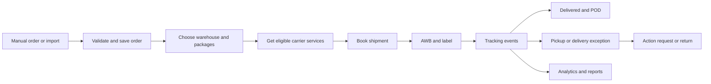

# Avon shipping platform build plan

## Recommended approach

Build one modular TypeScript application with a database and a background worker. Start with synthetic data and carrier adapters that simulate responses. Add authorized live carrier integrations after the operational workflows work. Keep orders, shipments and tracking events as separate records.

The reference application's implementation stack is unknown. The choices below are recommendations for our product, not claims about eShipz.

## Tools and services

| Need | Proposed tool | Purpose |
|---|---|---|
| Web application | React + TypeScript + Next.js | Shared layouts, pages and our server endpoints |
| UI | Tailwind CSS + shadcn/ui, one SVG icon family | Original Avon styling with reusable forms, dialogs, navigation and cards |
| Operational tables | TanStack Table | Sorting, filtering, row selection, pagination and column controls |
| Forms | React Hook Form with shared schema validation | Repeatable address/item/invoice/package sections and useful field errors |
| Storage | PostgreSQL | Orders, shipments, events, users, rules and reporting records |
| Charts | React-compatible chart library, selected during analytics implementation | Trend, status and carrier comparisons; licensed map geometry for state maps |
| Background processing | BullMQ with Redis, added when imports/tracking/report jobs require it | Retries, progress, scheduling and rate-limited carrier calls |
| Documents | Private object storage and server-side PDF generation | Labels, invoices, POD files and expiring report downloads |
| Import/export | Maintained CSV parser and spreadsheet library selected after template requirements | Preview, mapping, validation and per-row errors |
| Authentication | Maintained authentication library or managed provider | Sessions, recovery and optional SSO; server-enforced roles |
| Testing | Playwright plus focused unit/integration tests | Critical workflows, visual checks, permissions and carrier failure cases |
| Delivery | GitHub CI and a host that supports the web app, worker and database | Reproducible builds, deployments and backups |

No paid design plugin is necessary to begin. Figma is optional for stakeholder mockups. Git, Node.js and npm are available in the workspace environment. No packages, accounts or hosting services were installed or purchased during this audit.

Official references checked for the proposal:

- [Next.js App Router](https://nextjs.org/docs/app)
- [shadcn/ui components](https://ui.shadcn.com/docs)
- [TanStack Table](https://tanstack.com/table/latest)
- [React Hook Form](https://react-hook-form.com/)
- [PostgreSQL](https://www.postgresql.org/about/)
- [BullMQ background jobs](https://docs.bullmq.io/guide/introduction)
- [Playwright](https://playwright.dev/docs/intro)

Pin compatible package versions when scaffolding; do not treat a generic latest-version suggestion as a tested dependency set.

## Application structure

Suggested routes:

```
/login
/dashboard
/orders                         status and filters in query parameters
/orders/new
/orders/import
/orders/:id
/shipments
/shipments/new
/shipments/:id
/shipments/tracking-import
/returns
/pod
/exceptions/ndr
/exceptions/npr
/analytics/:view
/settings/carriers
/settings/warehouses
/settings/shipping-rules
/settings/packages
/settings/sku-mapping
/settings/webhooks
/reports
/settings/company
/settings/users
```

Company and user administration routes are proposed requirements, not inspected reference screens.

Core records: Organization, User, Membership/Role, Warehouse, CustomerAddress, Order, OrderItem, Invoice, Package, Shipment, ShipmentOrderLink, CarrierAccount, CarrierService, TrackingEvent, ExceptionCase, ExceptionAction, ReturnRequest, PODDocument, PODReview, ShippingRule, ImportJob, ImportRowError, ReportDefinition, ReportRun, WebhookEndpoint, WebhookDelivery and AuditEvent. Add finance-specific entities only when reconciliation scope is defined.

Store address and package snapshots on shipments so later address-book edits do not rewrite shipping history. Store money as decimal or integer minor units, timestamps in UTC with explicit display timezone, and weights/dimensions with explicit units. Support partial/multiple shipments through shipment-order links if required; confirm split/merge rules before implementing them.

Main flow:



Live carrier calls run only on the server. Use a common adapter interface for serviceability, rates, booking, cancellation, tracking and POD, with provider-specific capability flags. Persist booking attempts and use idempotency to prevent duplicate bookings after timeouts or retries. Keep raw provider status and normalized operational status together. Verify webhook signatures, deduplicate events and tolerate delayed/out-of-order tracking updates.

## Build phases and acceptance criteria

1. **Interface foundation:** original Avon branding, login shell, dashboard, orders, shipments, reusable tables, filters, date range, column chooser, dialogs and forms using synthetic records. Navigation and interaction must work, and every placeholder feature must be labeled clearly.
2. **Core working product:** authentication/roles, PostgreSQL, warehouse management, manual orders, imports with error previews, shipment creation against a simulated provider, tracking timeline, labels and basic reports. Reloading must preserve data; unauthorized access must be rejected by the server.
3. **Live shipping:** integrate one priority carrier using an approved sandbox, then production credentials. Verify serviceability/rates, booking idempotency, AWB/label generation, cancellation, tracking and POD against that carrier's capabilities.
4. **Operations:** reverse shipments, NDR/NPR action handling, manual POD review, allocation rules, asynchronous imports, scheduled reports and outbound webhooks. Bulk operations must report partial failures and allow safe retries.
5. **Advanced modules:** multi-carrier allocation, channel sync, freight reconciliation, NPS and optional automated POD scoring or embedded BI, based on confirmed business need and authorized services.

Before release, test order-to-shipment consistency, cross-role access, filter/pagination behavior, invalid import rows, duplicate carrier callbacks, failed/time-out bookings, returns, report date boundaries and keyboard navigation. Verify primary desktop layouts plus narrow-screen fallbacks. Use synthetic records in visual tests.

## Inputs required later

- Avon logo/color preferences and whether the product is internal-only or serves multiple client organizations.
- Roles and which staff can book, cancel, import, export and administer integrations.
- Priority carrier and its official API documentation, sandbox credentials, contracted services and label requirements. Credentials belong in a secret store, not Git or browser code.
- Required order/import templates and a small anonymized sample; no production export is needed for the prototype.
- Domain/hosting ownership, database region, retention/backup requirements and expected shipment volume.
- Email/SMS/WhatsApp provider access only if those communication features are in scope.
- Carrier billing/rate-card sources before implementing freight audit, COD settlement or financial reconciliation.

Our own operational UI, database, manual workflows, reports and simulated integrations can be built first. Actual bookings, rates, tracking, delivery proof and financial settlement depend on the authorized external systems that supply those capabilities.
